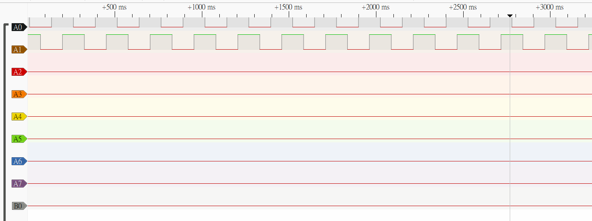

# DFSDM microphone sampling on STM32L4 with CMSIS-RTOS

Optional problem 1: the on-board MEMS microphone is recorded continuously through DFSDM + DMA under CMSIS-RTOS (FreeRTOS), and two GPIO pins toggle on the DMA half/full events so the audio sampling frequency can be observed on a logic analyzer.

The DFSDM setup follows the ST DFSDM hands-on video (STM32L4 MOOC); the RTOS and GPIO toggling are added for the assignment.

## Hardware

| Signal | Pin |
|---|---|
| Microphone clock (DFSDM1_CKOUT) | PE9 |
| Microphone data (DFSDM1_DATIN2) | PE7 |
| PIN1: top half of buffer filled | PA4 (Arduino D7) → logic analyzer A0 |
| PIN2: bottom half of buffer filled | PB2 (Arduino D8) → logic analyzer A1 |

Board: B-L475E-IOT01A (MP34DT01 microphone). The project targets STM32L476VGTx, which shares device ID 0x415 with the board's STM32L475.

## Configuration

| Setting | Value |
|---|---|
| System clock | 80 MHz (MSI + PLL) |
| DFSDM output clock divider | 40 → 2 MHz microphone clock |
| DFSDM channel 2 | SPI, rising edge, internal clock |
| DFSDM filter 0 | Sinc3, Fosr 250, Iosr 1, fast mode, continuous, software trigger, DMA |
| Sampling frequency | 2 MHz / 250 = **8 kHz** |
| DMA | DMA1 channel 4, peripheral → memory, word, circular |
| Buffer | `int32_t RecBuf[1024]` |
| RTOS | FreeRTOS, CMSIS_V2 interface, HAL timebase on TIM6 |

## How it works

All code is in [Core/Src/main.c](Core/Src/main.c).

1. `HAL_DFSDM_FilterRegularStart_DMA()` starts continuous conversion into `RecBuf`.
2. When the top half (512 samples) is full, `HAL_DFSDM_FilterRegConvHalfCpltCallback()` toggles PIN1 and sets a flag.
3. When the bottom half is full, `HAL_DFSDM_FilterRegConvCpltCallback()` toggles PIN2 and sets a flag.
4. The RTOS task `StartDefaultTask()` copies the finished half into `PlayBuf`, shifting each sample right by 8 bits to drop the channel/status bits and keep the 24-bit audio value.

## Result

Captured with a ZEROPLUS LAP-C(162000) in PulseView:

- Each pin toggles about every 128 ms.
- A PIN1 edge to the next PIN2 edge is about 64 ms, so 512 samples / 64 ms = **8 kHz**, matching the configuration.

## Build and flash

- **STM32CubeIDE:** File → Import → Existing Projects into Workspace, select this folder, build, then Run.
- **Without CubeIDE:** run `demo/build.bat`, then `demo/flash.bat` with the board connected. Both use the toolchain bundled with ST's STM32 VS Code extension.
